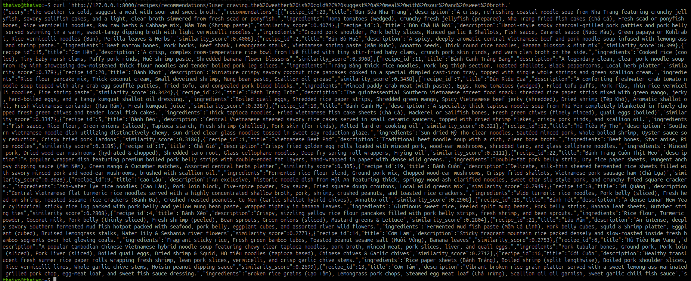

# meal-planner
Python app to find/suggest meals based on data provided by customer

## Setup python
Refer https://fastapi.tiangolo.com/virtual-environments/#virtual-environments for detailed virtual environment installation

Quick steps for working:
Install uv
Create virtual environment:``uv venv``
Activate virtual environment: ``source .venv/bin/activate``
Refer [link](https://fastapi.tiangolo.com/virtual-environments/#check-the-virtual-environment-is-active) to check if virtual environment is active
Install packages directly: ``uv pip install "fastapi[standard]"``

[Why Virtual Environments](https://fastapi.tiangolo.com/virtual-environments/#why-virtual-environments)

## How to start backend service
Run the command in the main dir: ``uv run fastapi dev``

## Manual Testing
Example:
In terminal, run the curl command to send a request:
